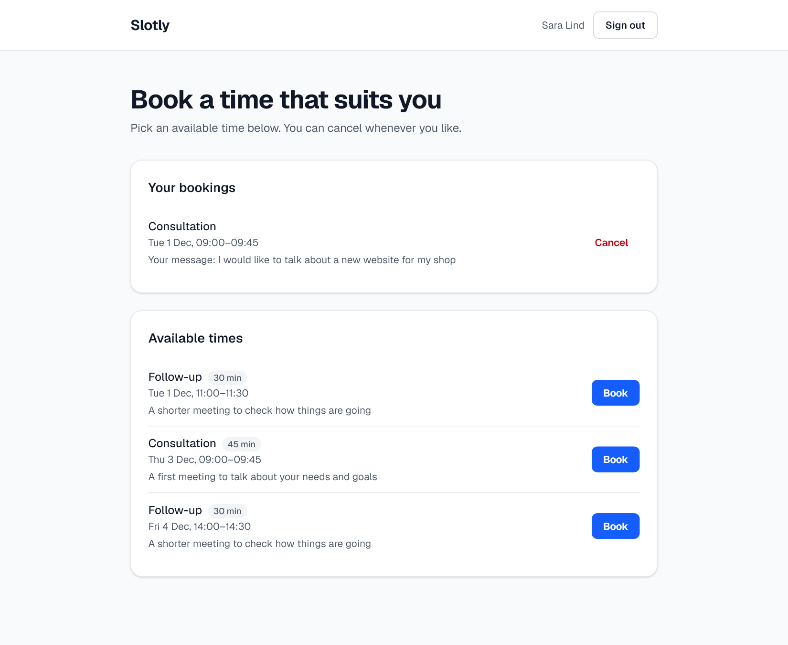
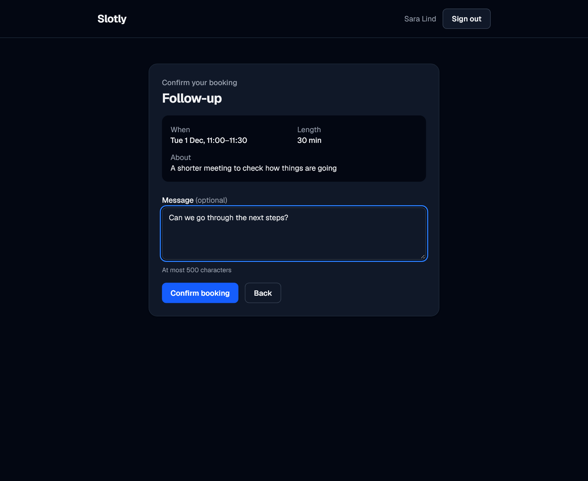
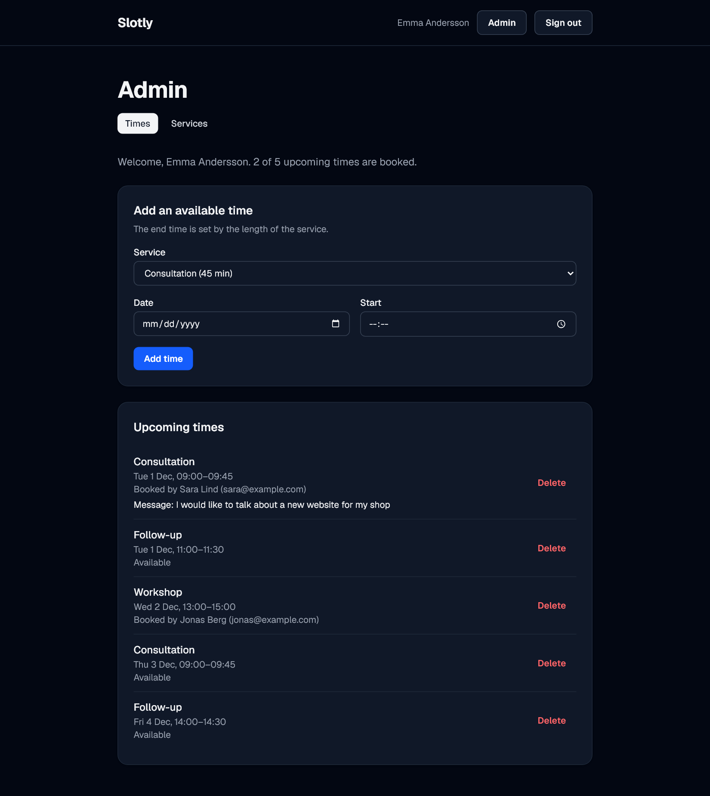

# Slotly – Booking App

[](https://github.com/alexanderjonasson/booking-app/actions/workflows/ci.yml)

A full-stack booking app for small businesses. The business adds services and available times, and customers sign in to book a time, leave a message and cancel if plans change.

I built it to practise the parts that real products need beyond the basics: user accounts with roles, validation on the server, accessibility, and automated tests that run on every push.

By [Alexander Jonasson](https://github.com/alexanderjonasson).



<p>
  
  
</p>

## Features

**For customers**

- Create an account and sign in
- See available times with the service, its length and a description
- Book a time on its own page, with an optional message
- See and cancel your own bookings

**For the business (admin)**

- Add services with a name, length and description
- Add available times – the end time is set by the length of the service
- See every upcoming time, who booked it and their message
- Remove services and times

**Built in**

- A time can never be booked twice, not even if two customers confirm at the same moment
- Customers can only cancel their own bookings, and only admins can reach the admin pages
- Light and dark mode that follows the system setting
- Works on mobile, with a keyboard and with a screen reader

## Tech stack

| | |
| --- | --- |
| Framework | Next.js 16 (App Router, Server Components, Server Actions) with React 19 |
| Language | TypeScript in strict mode |
| Database | PostgreSQL in Docker, with Prisma as the ORM |
| Auth | Better Auth, email and password, with a `role` field |
| Validation | Zod |
| Styling | Tailwind CSS |
| Testing | Vitest (unit), Playwright (end-to-end), axe-core (accessibility) |
| CI | GitHub Actions |

## How it works

- **Roles are checked on the server.** All checks of who is signed in live in a small data access layer (`src/lib/dal.ts`), marked `server-only`. Every page and every Server Action calls it, so hiding a button is never the only protection.
- **No double bookings.** `Booking.timeSlotId` is `@unique` in the database. Checking "is this time free?" in code is not enough when two requests arrive at the same time, so the database has the final say and the app turns the error into a friendly message.
- **Services decide the length.** Every time belongs to a service, and its end time is calculated from the service's length. Removed services are hidden instead of deleted, so old bookings still work.
- **Data migrations.** When times were linked to services, existing times got a general "Appointment" service in the same migration, so no data was lost.
- **Validation in one place.** The rules for services, times and bookings are plain functions in `src/lib/` that are easy to unit test. The Server Actions use them and send the typed values back on error, so forms keep what the user wrote.

## Testing and accessibility

The project has **23 unit tests** and **25 end-to-end tests**, and all of them run in CI on every push.

- **Unit tests** (Vitest) cover the validation rules, for example that a time can't be in the past and that the end time is calculated correctly.
- **End-to-end tests** (Playwright) use a real browser against a production build and a separate test database. They cover booking and cancelling, two customers booking the same time, roles and the admin pages.
- **Accessibility tests** use axe-core to check every main page against WCAG 2.1 AA, in both light and dark mode. The app also has a skip link, visible focus rings, labels on every input and buttons that say what they do to screen readers (for example "Book Consultation Tue 1 Dec, 09:00–09:45").

## Getting started

You need Node.js 24 and Docker Desktop.

```bash
git clone https://github.com/alexanderjonasson/booking-app.git
cd booking-app
npm install
cp .env.example .env
```

In `.env`, set your own database password (in both places) and generate an auth secret with `npx auth@1.7.26 secret`. Then start the database and the app:

```bash
docker compose up -d
npx prisma migrate dev
npm run dev
```

Open [http://localhost:3000](http://localhost:3000) and create an account. To make it an admin:

```bash
npm run make-admin -- you@example.com
```

## Running the tests

```bash
npm test                          # unit tests
npx playwright install chromium   # once, downloads the test browser
npm run test:e2e                  # end-to-end and accessibility tests
```

The end-to-end tests create their own database (`booking_test`) next to the app's database, so your own data is never touched.

## Project structure

```
src/
  app/              Pages, layouts and Server Actions
    admin/          Admin pages for times and services
    book/[timeSlotId]/  The page where a customer confirms a booking
  components/       Forms, header and admin navigation
  lib/              Auth, data access layer, validation rules and shared styles
e2e/                Playwright tests and helpers for the test database
prisma/             Database schema and migrations
scripts/            make-admin script
```

## Next steps

- Use a fixed time zone (Europe/Stockholm), so times are the same wherever the server runs
- Booking confirmations by email
- A calendar view for the admin
- A live demo with demo accounts
